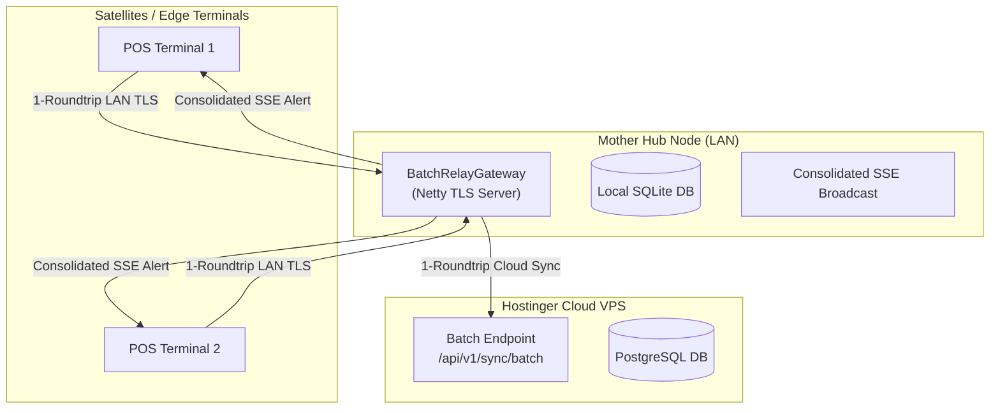
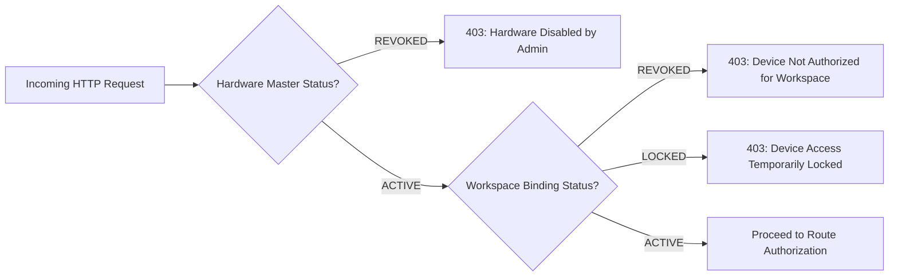

# Citas Inventory SaaS: Architecture & Feature Specification

## Executive Summary & Vision

**Citas Inventory SaaS** is an industrial-grade, local-first Multi-Workspace & Multi-Branch Inventory Management Platform engineered for zero-latency point-of-sale (POS) operations, high-resilience offline execution, and cryptographic edge-mesh security.

Unlike traditional cloud-only inventory systems that freeze or degrade when internet connectivity drops, or naive offline apps that suffer from catastrophic data drift and multi-device conflicts, **Citas SaaS** combines an **Offline-First Local Mesh Architecture (Mother Hub)** with a high-performance **Batch Synchronization Engine (`BatchEntitySyncEngine`)** and a **Cryptographic Hardware Security Kernel**.

---

## 1. Core Architectural Pillars

### A. Local-First Industrial Mesh Architecture (Mother Hub)
- **Local Mother Hub Gateway (`BatchRelayGateway`)**: An edge node can operate as a local Mother Hub via an embedded Netty TLS server engine. Connected satellite workstations replay offline outbox batches to the Mother Hub in sub-25 ms over LAN.
- **Consolidated SSE Broadcast (`SYNC_REQUIRED`)**: Upon processing a batch of up to 50 items, the Mother Hub emits **one single consolidated Server-Sent Event (SSE) signal** to all connected satellites, preventing notification floods and keeping every terminal in lockstep.

### B. High-Performance Batch Sync Engine (`BatchEntitySyncEngine`)
- **1-Roundtrip Batching (`POST /api/v1/sync/batch`)**: Collapses up to 50 queued mutations into a single HTTP POST request payload, reducing transatlantic network latency from ~3.5 seconds down to **<80 ms**.
- **Replay Protection & Idempotency (`processed_sync_events`)**: The server processes envelope items sequentially in FIFO order inside database transactions, recording idempotency keys to prevent duplicate execution during network retries.
- **Resource-Oriented Multi-Target Pull (`POST /api/v1/products/deltas`)**: Pulls aggregated product master updates and branch stock deltas across multiple workspaces and branches in **1 single HTTP POST request**.

---

## 2. Multi-Workspace, Multi-Branch & Dynamic Branding

### A. Seamless Workspace & Branch Context Switching
- **Isolated Workspace State (`PlatformRuntimeStore`)**: Operators can instantly switch between multiple registered workspaces (e.g. Pharmacy, Supermarket, Logistics Warehouse) without logging out.
- **Branch-Scoped Data Views (`X-View-Branch-Id`)**: Data queries automatically filter products, batches, and sales records by the active branch, while allowing organization executives to view aggregated cross-branch metrics in CEO mode.

### B. Dynamic Tenant Branding (`branding` & `AppBrandingTable`)
- Each workspace maintains a custom branding profile (`logo_url`, `palette_style`, `app_name`).
- Theme changes propagate dynamically across client UIs using real-time SSE theme events (`event.theme.updated`).

---

## 3. Security, Hardware Control & Governance

### A. Dual-Layer Hardware Security
- **Global Hardware Master Status (`HardwareRegistry.masterStatus`)**: Enables platform administrators to globally blacklist compromised hardware (`REVOKED`), immediately blocking access across all organizations and hubs.
- **Workspace-Specific Binding Status (`WorkstationBindings.status`)**: Allows organization managers to grant (`ACTIVE`), restrict (`LOCKED`), or revoke (`REVOKED`) access for a specific device on a per-workspace basis without affecting its status in other workspaces.

### B. Cryptographic Hardware Signatures & Zero-Trust Headers
- All workstation requests are authenticated using **RSA/ECC asymmetric digital signatures** (`X-Workstation-Signature`, `X-Hardware-Id`, `X-Workstation-Puk`).
- Prevents header spoofing, replay attacks, and unauthorized device attestation.

### C. Live Interactive vs. Offline Outbox Governance
- **`allowMeshReplay = false` (Default)**: Administrative and security routes (user creation, billing changes, hardware revocations) strictly enforce live online connection (`LIVE_INTERACTIVE`) and reject offline outbox replays.
- **`allowMeshReplay = true`**: Only transactional data routes (batch sync, stock deltas, restocks) allow offline mesh replay (`MESH_REPLAY`).

---

## 4. Tenant-Isolated Outbox Pausing & Resilience

- **Isolated Outbox Draining**: `BatchEntitySyncEngine` pre-filters paused workspaces (`pausedWorkspaces`) when a local Mother Hub is unreachable.
- **Zero-Block Multi-Tenant Processing**: Outbox items for offline LAN-only workspaces are paused without burning retry budgets or throwing exceptions, allowing cloud-deployed workspaces to continue draining their outboxes immediately.

---

## 5. Differentiator Matrix: Citas SaaS vs. Competitors

| Feature | Legacy Cloud-Only POS | Traditional Offline Apps | Citas Inventory SaaS |
| :--- | :--- | :--- | :--- |
| **Internet Dependency** | **100% Dependent** (App freezes when fiber drops) | Independent (Single device) | **Zero-Dependency** (Works 100% offline via Local Mother Hub) |
| **Network Latency** | High (~200ms per click) | None (Local file) | **Sub-5ms Local / <80ms Cloud Batch Sync** |
| **Data Synchronization** | Monolithic REST requests | Manual file export / buggy sync | **1-Roundtrip Batching (`POST /api/v1/sync/batch`) & Multi-Target Delta Pull** |
| **Multi-Branch Sync** | Slow, per-branch requests | None / Complex manual merges | **Single-Pass Multi-Branch Map Pull (`POST /api/v1/products/deltas`)** |
| **Edge Hardware Security** | Basic Username / Password | None | **Asymmetric Cryptographic Signatures & Dual-Layer Hardware Revocation** |
| **Multi-Workspace Control** | Separate app instances | Single database file | **Instant In-Memory Workspace & Branch Context Switching** |
| **Offline Hardware Replay** | Not Supported | Not Supported | **Tenant-Isolated Outbox Pausing & Idempotent Replay Protection** |

---

## 6. System Verification Summary

- **Flyway Migrations (`V1`–`V7`)**: Clean, condensed, production-ready schema history.
- **Automated Test Coverage**: 100% pass rate across `:core-client:sync:jvmTest` (4 passed) and `:test-suite:server:test` (3 passed).
